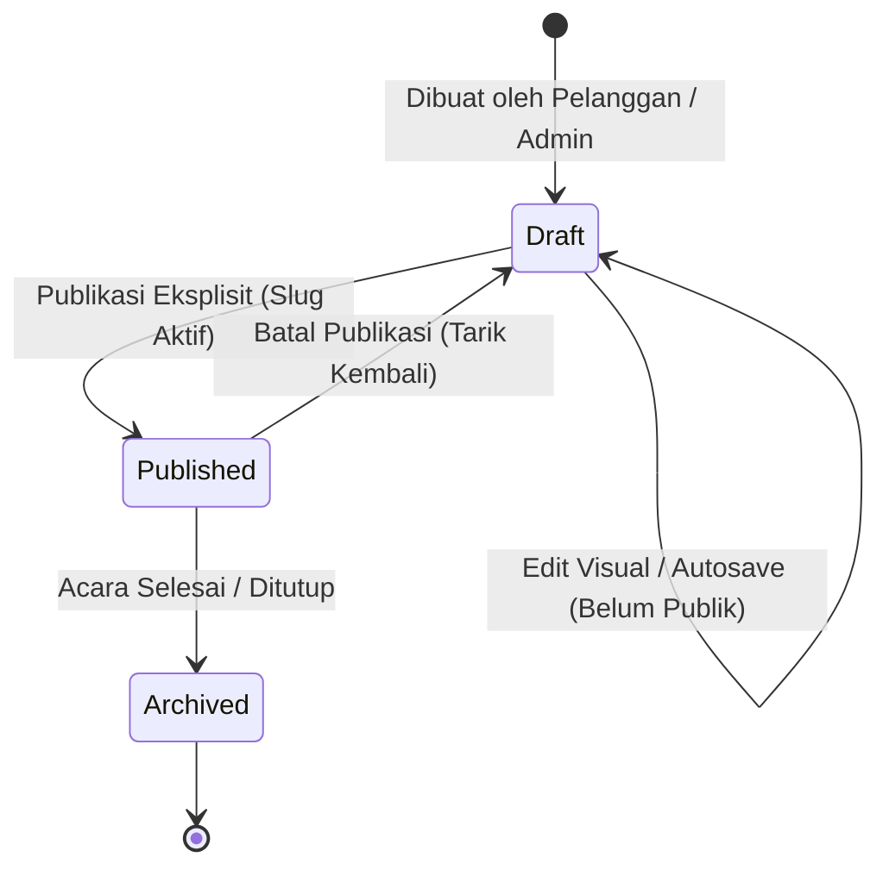

# Context: Niskala Digital Invitation Platform

**Dokumen Acuan:** `docs/project-plan-undangan-digital.md`  
**Nama Proyek:** Niskala  
**Status:** Fondasi awal & persiapan pengembangan modul  
**Repositori:** `/var/www/html/niskala`

---

## 1. Visi & Tujuan Produk

**Niskala** adalah platform layanan pembuatan dan pengelolaan undangan digital modern yang menggabungkan kemudahan pembuatan mandiri (*self-service*) dan layanan berbantuan admin (*assisted service*).

### Tujuan Utama:
1. **Penyusun Undangan Visual (Editor Bebas Kode):** Pelanggan dapat membuat, menata, dan memodifikasi undangan mereka sendiri melalui antarmuka visual berbasis section/block.
2. **Layanan Hybrid (Admin Support):** Pelanggan yang membutuhkan bantuan dapat mengajukan permintaan agar admin membantu menyusun atau merapikan undangan melalui engine yang sama.
3. **Pengalaman Publik yang Cepat & Mobile-First:** Setiap undangan yang dipublikasikan dapat diakses secara publik melalui URL ramah pengguna (`domain.com/{slug}`) dengan tampilan mobile yang responsif, elegan, dan kaya interaksi.
4. **Data Terstruktur & Kompatibilitas Jangka Panjang:** Konten undangan disimpan sebagai dokumen terstruktur (JSON schema) dengan registry komponen terdaftar, mencegah eksekusi kode berbahaya dan memastikan perubahan versi platform tidak merusak undangan lama.
5. **Model Bisnis Awal:** Layanan undangan digital langsung. Fitur otomatisasi pembayaran/SaaS bukan prasyarat awal; fokus utama adalah validasi alur layanan, keandalan editor, dan kepuasan pengalaman tamu.

---

## 2. Arsitektur Teknis & Lingkungan

### 2.1 Komponen Sistem
```text
Klien / Tamu / Pengguna
          │
          ▼
   Nginx Reverse Proxy (:8031)
          │
          ├── /               → Frontend Container (React 19 SPA, Vite)
          ├── /api/*          → Backend Container (Laravel 12 REST API)
          ├── /storage/*      → Media Storage (Foto, Musik, Galeri)
          ├── /docs/*         → Dokumentasi OpenAPI / Swagger UI
          └── /up             → Health Check Endpoint
                                     │
                                     ▼
                               MySQL 8.0 (:3320)
```

### 2.2 Stack Teknologi
* **Backend:**
  * PHP 8.3+, Laravel 12
  * Autentikasi: Laravel Sanctum (Token-based)
  * Database: MySQL 8.0 (`utf8mb4_unicode_ci` untuk dukungan emoji & karakter khusus)
  * Dokumentasi API: L5-Swagger / OpenAPI 3.0
* **Frontend:**
  * React 19, Vite 7
  * UI Framework: CoreUI React (Dashboard & Controls) + SCSS
  * State Management: Redux (App/Auth) + Local State / Reducer (Canvas Editor)
  * Routing: React Router (`HashRouter` untuk dashboard internal, path routing untuk publik)
* **DevOps & Lingkungan:**
  * Multi-container Docker Compose (`db`, `backend`, `frontend`, `nginx`)
  * Named Volumes untuk persistensi media (`niskala-storage`), database (`niskala-db-data`), dan logs (`niskala-logs`)

---

## 3. Peran Pengguna (User Roles)

1. **Administrator (Admin):**
   * Mengelola katalog tema dan komponen sistem.
   * Mengelola akun pengguna/pelanggan.
   * Meninjau dan memproses permintaan bantuan pembuatan undangan.
   * Mengakses seluruh undangan dan log operasional sistem.
2. **Pelanggan (Host / Pengantin / Penyelenggara):**
   * Mengelola undangan miliknya sendiri (draft, pratinjau, publikasi, arsip).
   * Menyesuaikan konten melalui Visual Editor.
   * Mengelola daftar tamu undangan dan memonitor konfirmasi kehadiran (RSVP).
   * Mengajukan tiket permintaan bantuan ke admin jika diperlukan.
3. **Tamu (Guest / Publik):**
   * Membuka undangan publik via tautan `domain.com/{slug}`.
   * Mengisi formulir RSVP dan menuliskan ucapan/doa pada buku tamu.

---

## 4. Siklus Hidup Undangan (Invitation Lifecycle)



* **Draft:** Konten hanya bisa dilihat oleh pemilik atau admin melalui dashboard pratinjau internal. Tidak dapat diakses via URL publik.
* **Published:** Undangan aktif dan dapat dibuka oleh siapa saja via `domain.com/{slug}`. Form RSVP aktif menerima input.
* **Archived:** Undangan disimpan sebagai arsip, form RSVP dinonaktifkan, konten tetap dapat diakses atau diarahkan ke pesan penutup.

---

## 5. Entitas Data Utama & Konvensi Tabel

Untuk menjaga kerapian database, penamaan tabel menggunakan skema prefix terstruktur:
* **Tabel Master (`ms_`):**
  * `ms_themes`: Identitas tema, versi tema, palet warna bawaan, font, dan preset section.
* **Tabel Transaksi / Operasional (`tr_`):**
  * `tr_invitations`: Entitas undangan (pemilik `user_id`, judul, event type, status, slug, waktu publikasi).
  * `tr_invitation_contents`: Dokumen JSON tervalidasi (schema version, array ordered sections, settings).
  * `tr_invitation_events`: Rangkaian sesi acara (Akad, Resepsi, waktu, alamat, link Google Maps).
  * `tr_guests`: Daftar tamu undangan, kategori (VIP, Keluarga), dan token personalisasi link.
  * `tr_rsvps`: Jawaban kehadiran (hadir, tidak hadir, ragu), perkiraan pax, dan doa/ucapan buku tamu.
  * `tr_service_orders`: Tiket permintaan bantuan dari pelanggan ke admin beserta status pengerjaannya.
* **Tabel Log & Audit (`log_`):**
  * `log_audits`: Pencatatan tindakan kritis admin dan perubahan sistem.
* **Tabel Bawaan Sistem / Laravel (Tanpa Prefix):**
  * `users`, `roles`, `menus`, `rolemenus`, `companies`, `personal_access_tokens`, `cache`, `jobs`.

