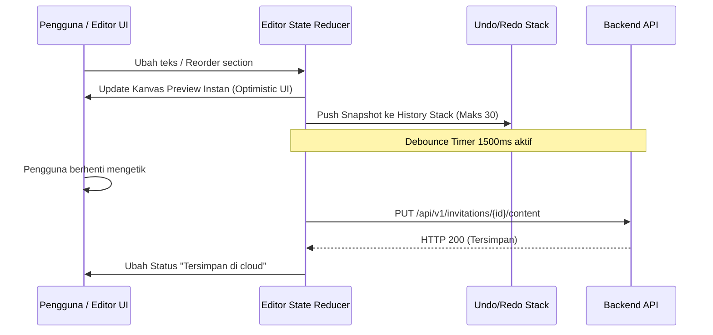

# PRD 02: Visual Drag-and-Drop Editor

**Fase Roadmap:** Fase 2 (Editor Visual Undangan)  
**Dokumen Acuan:** [project-plan-undangan-digital.md](file:///var/www/html/niskala/docs/project-plan-undangan-digital.md) | [design.md](file:///var/www/html/niskala/docs/design.md) | [rules.md](file:///var/www/html/niskala/docs/rules.md)  
**Status:** Draf Spesifikasi Lengkap

---

## 1. Ringkasan & Tujuan Produk

Visual Editor adalah antarmuka inti bagi pelanggan dan admin untuk menyusun, menyesuaikan konten, mengatur urutan bagian (*sections*), memilih foto, dan mempratinjau undangan digital secara *real-time*. Editor dirancang berbasis **blok/section terstruktur** (bukan kanvas bebas tanpa batas) guna menjamin hasil akhir selalu responsif, estetis, dan konsisten di seluruh perangkat.

---

## 2. Arsitektur Antarmuka (4 Zona Layout)

Layout editor mengacu pada panduan [design.md](file:///var/www/html/niskala/docs/design.md):

```text
┌────────────────────────────────────────────────────────────────────────────────────────┐
│ TOP BAR: [← Dashboard] [Judul Undangan] [Status: Tersimpan] [Undo] [Redo] [Preview] [Publish]│
├────────────────────┬──────────────────────────────────────────┬────────────────────────┤
│ PANEL KIRI         │ KANVAS TENGAH (PREVIEW INTERAKTIF)       │ PANEL KANAN            │
│ (Komponen/Section) │                                          │ (Property Inspector)   │
│                    │         ┌───────────────────────┐        │                        │
│ ⊕ Tambah Section:  │         │   Bingkai Mobile      │        │ Section Terpilih:      │
│ • Hero Cover       │         │   (375px / 390px)     │        │ [ Hero Cover ]         │
│ • Profil Mempelai  │  Drag   │                       │  Klik  │                        │
│ • Rangkaian Acara  │  ─────► │   ☰ [ Hero Cover    ] │ ─────► │ • Judul Acara          │
│ • Countdown Timer  │         │   ☰ [ Mempelai      ] │        │ • Upload Gambar Cover  │
│ • Lokasi & Peta    │         │   ☰ [ Countdown     ] │        │ • Tanggal & Jam        │
│ • Galeri Foto      │         │   ☰ [ Acara/Jadwal  ] │        │ • Opsi Tombol Buka     │
│ • Formulir RSVP    │         │   ☰ [ RSVP Form     ] │        │                        │
│ • Musik Latar      │         └───────────────────────┘        │ [Hapus] [Duplikat]     │
└────────────────────┴──────────────────────────────────────────┴────────────────────────┘
```

### 2.1 Top Action Bar
* **Indikator Autosave:** Menampilkan status sinkronisasi ke server: `Idle`, `Menyimpan...` (spinner kecil), `Tersimpan di cloud` (centang hijau), atau `Gagal menyimpan` (peringatan merah dengan tombol coba lagi).
* **Riwayat Lokal (Undo / Redo):** Tombol kembali ke state sebelumnya atau maju ke depan selama sesi penyuntingan berlangsung.
* **Toggle Viewport:** Pilihan pratinjau antara *Mobile Frame* (375px/390px — default) dan *Desktop Full Width*.
* **Aksi Dokumen:** Tombol modal *Pratinjau Penuh* (*Full Preview*) dan Tombol *Publikasikan* (*Publish*).

### 2.2 Panel Kiri (Section Library Palette)
* Daftar kartu komponen yang tersedia dari **Component Registry**.
* Mendukung penambahan komponen dengan cara:
  1. *Drag-and-Drop* langsung ke kanvas pada posisi yang diinginkan.
  2. Klik tombol `+ Tambah` untuk meletakkan komponen di urutan paling bawah kanvas.

### 2.3 Kanvas Tengah (Live Interactive Canvas)
* Menampilkan pratinjau langsung isi undangan persis seperti yang akan dilihat tamu.
* Interaksi antar-section:
  * Pengurutan ulang (*reordering*) posisi section ke atas/ke bawah menggunakan *drag handle* (`dnd-kit`).
  * Highlight border emas (*Muted Gold* `#A68B65`) pada section yang sedang aktif diklik.
  * Tombol melayang cepat (*quick actions*) di pojok section aktif: *Geser Atas*, *Geser Bawah*, *Duplikat*, dan *Hapus*.

### 2.4 Panel Kanan (Property Inspector)
* Menampilkan formulir input yang menyesuaikan secara dinamis dengan section yang sedang dipilih:
  * **Hero Cover:** Input teks judul, tanggal, nama panggilan pengantin, upload gambar latar.
  * **Profil Pasangan:** Upload foto pria & wanita, nama lengkap, nama orang tua, tautan Instagram/media sosial.
  * **Acara & Jadwal:** Pilihan nama sesi (Akad, Resepsi), waktu mulai-selesai, zona waktu, nama gedung, alamat, dan tombol sematkan link Google Maps.
  * **Countdown:** Target waktu hitung mundur.
  * **Galeri Foto:** Multi-image upload, opsi tata letak grid / carousel.
  * **Musik Latar:** Pilih musik bawaan tema atau upload file audio `.mp3` kustom.

---

## 3. Component Registry & Skema Data Terstruktur

Semua konten wajib terikat pada registry komponen yang tervalidasi. Struktur data disimpan dalam JSON `sections_data`:

```json
{
  "schema_version": "1.0",
  "theme_id": "classic-ivory",
  "sections": [
    {
      "id": "sec-hero-01",
      "type": "HeroCover",
      "is_active": true,
      "props": {
        "title": "The Wedding of",
        "primary_names": "Rama & Shinta",
        "date_text": "Sabtu, 12 Desember 2026",
        "bg_image_url": "storage/invitations/covers/hero-1.jpg",
        "open_button_text": "Buka Undangan"
      }
    },
    {
      "id": "sec-couple-02",
      "type": "CoupleProfile",
      "is_active": true,
      "props": {
        "groom_name": "Rama Wijaya, S.Kom.",
        "groom_parents": "Putra dari Bpk. Danu & Ibu Maya",
        "groom_photo": "storage/invitations/photos/groom.jpg",
        "bride_name": "Shinta Dewi, S.E.",
        "bride_parents": "Putri dari Bpk. Surya & Ibu Ratna",
        "bride_photo": "storage/invitations/photos/bride.jpg"
      }
    }
  ]
}
```

---

## 4. State Management, Undo/Redo, & Autosave



1. **State Immutability:** Seluruh manipulasi struktur section dilakukan secara *immutable* di frontend.
2. **Riwayat Lokal:** Stack undo/redo menyimpan maksimal 30 state perubahan. Undo/redo murni beroperasi di memori lokal tanpa membebani traffic backend.
3. **Autosave Terkelola:** Request penyimpanan otomatis ke endpoint `PUT /api/v1/invitations/{id}/content` dipicu setelah jeda pengetikan 1500ms (*debounce*).
4. **Optimistic Locking:** Request penyuntingan menyertakan `updated_at` atau `version` dokumen untuk mencegah penimpaan perubahan bersamaan (*concurrent edit conflict*).

---

## 5. Kriteria Penerimaan & Verifikasi (Acceptance Criteria)

1. [ ] **Manipulasi Section:** Pengguna dapat menambah, menggeser urutan, menduplikasi, dan menghapus section di kanvas tanpa reload halaman.
2. [ ] **Pratinjau Instan:** Setiap perubahan pada panel kanan langsung ter-render di kanvas preview dalam waktu `< 50ms`.
3. [ ] **Undo / Redo Berfungsi:** Tombol Undo mengembalikan kanvas ke state sebelumnya dengan tepat, dan tombol Redo memajukan kembali state.
4. [ ] **Autosave Berjalan:** Indikator status berubah dari *Idle* → *Menyimpan...* → *Tersimpan*, dan data draft tetap utuh saat halaman di-refresh.
5. [ ] **Keamanan Konten:** Input teks tersanitasi; tag `<script>` atau injeksi HTML tidak dieksekusi di kanvas preview.

