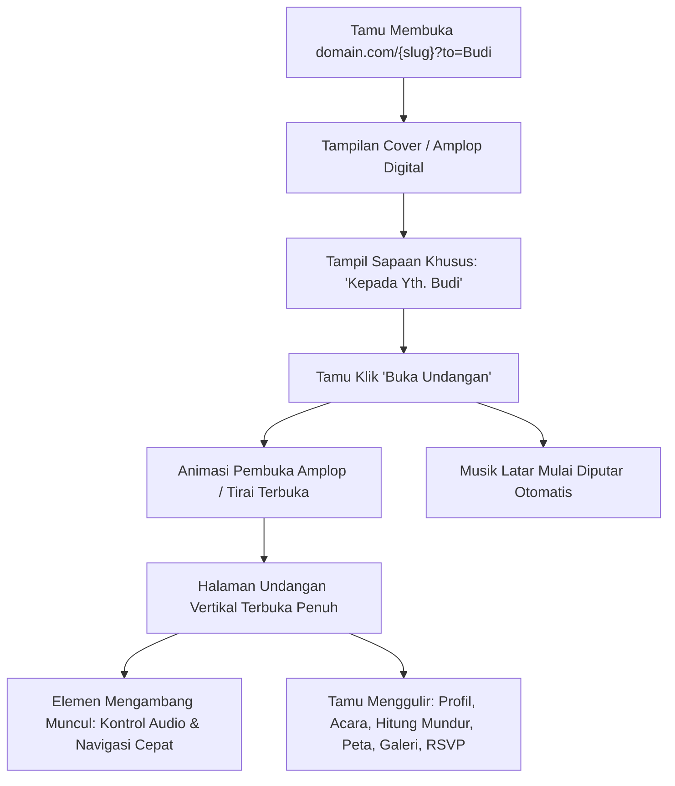

# PRD 04: Renderer Undangan Publik (Public Invitation Renderer)

**Fase Roadmap:** Fase 3 (Renderer Publik MVP)  
**Dokumen Acuan:** [project-plan-undangan-digital.md](file:///var/www/html/niskala/docs/project-plan-undangan-digital.md) | [design.md](file:///var/www/html/niskala/docs/design.md) | [rules.md](file:///var/www/html/niskala/docs/rules.md) | [03-visual-editor.md](file:///var/www/html/niskala/docs/prd/03-visual-editor.md)  
**Status:** Selesai Diimplementasikan (Fase 3 Renderer Publik MVP)

---

## 1. Ringkasan & Tujuan Produk

Renderer Publik adalah antarmuka yang diakses oleh tamu undangan ketika membuka URL `domain.com/{slug}`. Halaman ini harus sangat cepat, ringan, responsif pada perangkat seluler (*mobile-first*), serta menyajikan transisi animasi yang elegan dan interaktif dari saat tamu menerima amplop digital hingga mengisi buku tamu.

---

## 2. Alur Interaksi Pengguna (User Journey)



---

## 3. Komponen & Fitur Renderer Publik

### 3.1 Cover Pembuka (Gate / Envelope Section)
* **Modal Tirai Penuh (*Full-Screen Gate*):** Menutupi seluruh layar sebelum undangan dibuka agar konten tidak langsung bocor dan musik dapat diputar sesuai kebijakan browser.
* **Sapaan Personal Tamu:** Mengambil parameter URL `?to=Nama+Tamu` atau kode tamu unik untuk menampilkan:
  > *"Kepada Yth. Bpk/Ibu/Sdr/i: **Nama Tamu***\
  > *Tanpa mengurangi rasa hormat, kami mengundang Anda untuk hadir pada acara kami."*
* **Tombol *"Buka Undangan"*:** Tombol anggun beraksen emas (*Muted Gold*) yang:
  1. Membuka tirai amplop dengan animasi *smooth slide-up / fade-out*.
  2. Memulai pemutaran audio latar (*background music*).
  3. Mengaktifkan *scrolling* halaman utama.

### 3.2 Floating Controls (Elemen Mengambang)
1. **Floating Music Player:**
   * Tombol mengambang di pojok kanan/kiri bawah berwujud piringan hitam mini.
   * Berputar (*spin animation*) saat audio aktif (`play`), dan berhenti saat dimatikan (`pause`).
   * Tamu dapat mematikan atau menyalakan kembali musik sewaktu-waktu.
2. **Floating Quick Navigation Pill:**
   * Bilah navigasi melayang di tengah bawah layar untuk melompat cepat (*smooth scroll*) ke section:
     `Mempelai` • `Acara` • `Lokasi` • `Galeri` • `RSVP`.

### 3.3 Rangkaian Section Standar (MVP)
* **Hero Section:** Foto utama beresolusi tinggi dengan tipografi Serif perayaan dan tanggal acara.
* **Profil Pasangan / Penyelenggara:** Foto mempelai, nama lengkap, gelar, putra-putri dari orang tua, dan ikon tautan Instagram.
* **Hitung Mundur (*Countdown Timer*):** Hari, jam, menit, dan detik menuju waktu acara secara dinamis.
* **Rangkaian Acara (Sesi):** Rincian Akad, Resepsi, atau Ibadah dengan tombol interaktif *"Simpan ke Kalender"* (Google Calendar / .ics).
* **Lokasi & Penunjuk Arah:** Peta interaktif atau peta statis dengan tombol *"Buka di Google Maps"* dan *"Buka di Waze"*.
* **Galeri Foto:** Susunan foto-foto pre-wedding dalam bentuk grid responsif yang dapat diperbesar (*lightbox image viewer*) saat diklik.
* **Formulir RSVP & Buku Tamu:** Form konfirmasi kehadiran terpersonalisasi nama tamu dan kolom ucapan selamat.
* **Footer:** Ucapan terima kasih keluarga dan kredit platform Niskala.

---

## 4. Klarifikasi Desain: Tema Aplikasi vs Tema Undangan

1. **Tema Aplikasi (CMS Dashboard & Workspace Platform):**
   * Kaidah warna visual pada [design.md](file:///var/www/html/niskala/docs/design.md) (Mode Terang Ivory/Charcoal/Gold dan Mode Gelap Deep Espresso/Champagne Gold) berlaku untuk **antarmuka aplikasi Niskala** (dashboard, navbar, sidebar, card data, dan property inspector).
   * Dashboard Niskala mendukung switch instan antara *Light Mode* dan *Dark Mode*.

2. **Tema Khusus Undangan (Invitation Themes / Presets):**
   * Tema visual khusus untuk dekorasi undangan pernikahan (misalnya ragam gaya rustic, botanical floral, royal modern, tradisi adat nusantara) merupakan fitur lanjutan yang akan dikembangkan secara terpisah di masa mendatang (*Fase Katalog Tema Undangan*).
   * Pada tahap MVP PRD 04 ini, tampilan undangan publik difokuskan pada keterbacaan yang abadi (*timeless*), responsif di semua perangkat ponsel, serta terisolasi penuh (`.invitation-canvas-isolated`) dari tema gelap/terang dashboard admin.

---

## 5. SEO & Metadata Berbagi Media Sosial (OpenGraph)

Setiap halaman publik memuat tag OpenGraph lengkap untuk tampilan pratinjau tautan di WhatsApp, Telegram, Facebook, dan Twitter:
```html
<meta property="og:title" content="The Wedding of Rama & Shinta — Niskala" />
<meta property="og:description" content="Kami mengundang Anda untuk hadir pada perayaan pernikahan kami pada Sabtu, 12 Desember 2026." />
<meta property="og:image" content="https://domain.com/storage/invitations/covers/cover-og.jpg" />
<meta property="og:url" content="https://domain.com/rama-shinta" />
<meta property="og:type" content="website" />
```

---

## 6. Kriteria Penerimaan & Verifikasi (Acceptance Criteria)

1. [x] **Routing Slug Publik:** Mengakses `http://localhost:8031/#/p/{slug}` pada undangan berstatus `published` berhasil memuat undangan dengan benar.
2. [x] **Isolasi Draft:** Mengakses slug undangan yang masih berstatus `draft` mengembalikan respons `404 Not Found`.
3. [x] **Interaksi Amplop & Audio:** Mengklik tombol *"Buka Undangan"* membuka tirai dengan mulus dan memutar audio latar tanpa terblokir browser.
4. [x] **Responsif Mobile:** Tampilan diuji pada resolusi 360px, 375px, dan 414px tanpa horizontal scroll overflow (`overflow-x: hidden`).
5. [x] **Performa Cepat:** Lazy-loading gambar aktif, halaman publik dapat dimuat secara instan di jaringan 4G mobile.

