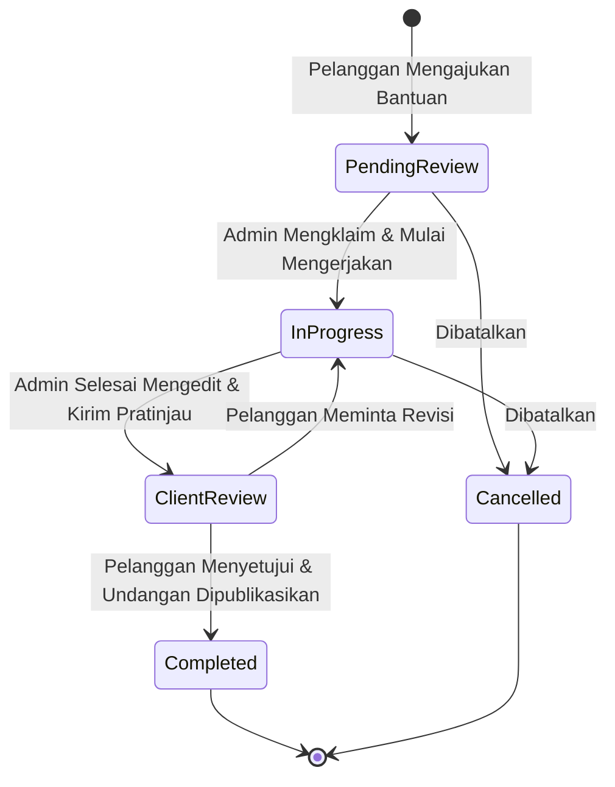

# PRD 06: Layanan Bantuan Admin & Operasional

**Fase Roadmap:** Fase 4 (Admin & Operasional Layanan)  
**Dokumen Acuan:** [project-plan-undangan-digital.md](file:///var/www/html/niskala/docs/project-plan-undangan-digital.md) | [rules.md](file:///var/www/html/niskala/docs/rules.md) | [context.md](file:///var/www/html/niskala/docs/context.md) | [02-navigasi-menu-dan-master-data.md](file:///var/www/html/niskala/docs/prd/02-navigasi-menu-dan-master-data.md)  
**Status:** Draf Spesifikasi Lengkap

---

## 1. Ringkasan & Tujuan Produk

Niskala menganut **model layanan *hybrid***: selain pelanggan dapat menyusun undangan mandiri (*self-service*), pelanggan juga dapat meminta bantuan tim admin untuk membuatkan, merapikan tata letak, atau mengunggah data acara mereka. Modul ini menyediakan sistem tiket permintaan layanan (*service orders*), alur kerja kolaborasi penyuntingan menggunakan engine editor yang sama, serta pencatatan audit (*audit logs*) untuk menjaga transparansi operasional.

---

## 2. Struktur Database & Skema Migrasi

### 2.1 Tabel `tr_service_orders`
```sql
CREATE TABLE `tr_service_orders` (
  `id` BIGINT UNSIGNED AUTO_INCREMENT PRIMARY KEY,
  `user_id` BIGINT UNSIGNED NOT NULL COMMENT 'Pelanggan yang meminta bantuan',
  `invitation_id` BIGINT UNSIGNED NULL COMMENT 'Undangan terkait (jika sudah ada)',
  `order_number` VARCHAR(50) NOT NULL UNIQUE COMMENT 'Format: SRV-YYYYMM-XXXX',
  `service_type` ENUM('full_creation', 'custom_styling', 'data_entry', 'review') NOT NULL DEFAULT 'full_creation',
  `status` ENUM('pending_review', 'in_progress', 'client_review', 'completed', 'cancelled') NOT NULL DEFAULT 'pending_review',
  `client_notes` TEXT NULL COMMENT 'Catatan atau instruksi khusus dari pelanggan',
  `admin_notes` TEXT NULL COMMENT 'Catatan internal tim admin',
  `assigned_admin_id` BIGINT UNSIGNED NULL COMMENT 'Admin yang bertanggung jawab',
  `completed_at` TIMESTAMP NULL,
  `created_at` TIMESTAMP NULL,
  `updated_at` TIMESTAMP NULL,
  FOREIGN KEY (`user_id`) REFERENCES `users`(`id`) ON DELETE CASCADE,
  FOREIGN KEY (`invitation_id`) REFERENCES `tr_invitations`(`id`) ON DELETE SET NULL,
  FOREIGN KEY (`assigned_admin_id`) REFERENCES `users`(`id`) ON DELETE SET NULL,
  INDEX `idx_service_status` (`status`),
  INDEX `idx_service_user` (`user_id`)
);
```

### 2.2 Tabel `log_audits`
Mencatat tindakan-tindakan penting yang dilakukan admin atau pelanggan demi akuntabilitas operasional.
```sql
CREATE TABLE `log_audits` (
  `id` BIGINT UNSIGNED AUTO_INCREMENT PRIMARY KEY,
  `user_id` BIGINT UNSIGNED NOT NULL,
  `action` VARCHAR(100) NOT NULL COMMENT 'e.g. invitation.published, service_order.status_updated',
  `target_type` VARCHAR(100) NOT NULL COMMENT 'e.g. App\\Models\\Invitation',
  `target_id` BIGINT UNSIGNED NOT NULL,
  `details` JSON NULL COMMENT 'Snapshot metadata perubahan yang dilakukan',
  `ip_address` VARCHAR(45) NULL,
  `created_at` TIMESTAMP NULL,
  FOREIGN KEY (`user_id`) REFERENCES `users`(`id`) ON DELETE CASCADE,
  INDEX `idx_audit_action_target` (`action`, `target_type`, `target_id`)
);
```

---

## 3. Alur Kerja Layanan Berbantuan (*Service Order Workflow*)



### Rincian Tahapan Alur:
1. **Pengajuan (Pending Review):** Pelanggan mengisi formulir permintaan bantuan, melampirkan teks acara, foto mempelai, dan instruksi khusus.
2. **Pengerjaan (In Progress):** Admin membuka tiket, menautkan undangan klien, lalu menyusun section menggunakan **Visual Editor** yang sama persis dengan yang dimiliki pelanggan.
3. **Pemeriksaan Pelanggan (Client Review):** Admin mengirimkan draf pratinjau. Pelanggan dapat membuka preview di dashboard mereka untuk meninjau kecocokan data.
4. **Penyelesaian (Completed):** Setelah disetujui, undangan dapat langsung dipublikasikan (`published`), dan status tiket diperbarui menjadi selesai.

---

## 4. Spesifikasi Endpoint REST API

### 4.1 Endpoint Pelanggan (Client Requests)
| Method | Endpoint | Fungsi |
|---|---|---|
| `POST` | `/api/v1/service-orders` | Pelanggan membuat tiket permintaan bantuan baru. |
| `GET` | `/api/v1/service-orders` | Pelanggan melihat riwayat permintaan bantuan miliknya. |
| `GET` | `/api/v1/service-orders/{id}` | Pelanggan melihat detail status dan instruksi tiket. |
| `POST` | `/api/v1/service-orders/{id}/approve` | Pelanggan menyetujui hasil pengerjaan admin. |

### 4.2 Endpoint Khusus Admin (`role.admin`)
| Method | Endpoint | Fungsi |
|---|---|---|
| `GET` | `/api/v1/admin/service-orders` | Melihat seluruh antrean permintaan layanan pelanggan. |
| `PUT` | `/api/v1/admin/service-orders/{id}/status` | Mengubah status tiket (*In Progress*, *Client Review*, *Completed*). |
| `PUT` | `/api/v1/admin/service-orders/{id}/assign` | Menugaskan admin tertentu untuk mengerjakan tiket. |
| `GET` | `/api/v1/admin/audit-logs` | Melihat riwayat pencatatan tindakan operasional admin. |
| `GET` | `/api/v1/admin/invitations` | Mengakses seluruh daftar undangan pelanggan di sistem. |

---

## 5. Kriteria Penerimaan & Verifikasi (Acceptance Criteria)

1. [ ] **Siklus Hidup Tiket:** Tiket layanan dapat bertransisi dengan mulus dari `pending_review` hingga `completed` tanpa anomali status.
2. [ ] **Kolaborasi Editor Aman:** Admin dapat mengedit undangan milik pelanggan melalui editor tanpa memicu pelanggaran hak akses (policy memperbolehkan akses jika role adalah `admin`).
3. [ ] **Audit Trail:** Setiap kali admin mengubah status tiket atau memodifikasi undangan pelanggan, entri log baru tercatat di tabel `audit_logs`.
4. [ ] **Proteksi Akses:** Endpoint `/api/v1/admin/*` diblokir dengan `403 Forbidden` jika diakses oleh user non-admin.

