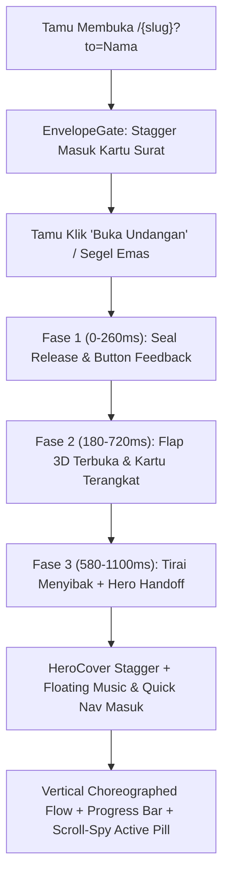

# PRD 07: Koreografi Animasi Surat Pembuka & Transisi Antar-Slide

**Fase Roadmap:** Fase 5 (Polesan Pengalaman Interaktif — Animasi & CSS Undangan)  
**Dokumen Acuan:** [project-plan-undangan-digital.md](file:///var/www/html/niskala/docs/project-plan-undangan-digital.md) | [design.md](file:///var/www/html/niskala/docs/design.md) | [rules.md](file:///var/www/html/niskala/docs/rules.md) | [04-renderer-publik-dan-tema.md](file:///var/www/html/niskala/docs/prd/archive/04-renderer-publik-dan-tema.md)  
**Status:** Diimplementasikan (Build & Automated Tests Lolos; Audit Visual Chrome Tertunda)

---

## 1. Ringkasan, Tujuan & Batasan

### 1.1 Tujuan Produk & Teknis
Menghilangkan kesan kaku pada pembuka "surat" ([`EnvelopeGate`](file:///var/www/html/niskala/frontend/src/views/public/EnvelopeGate.js)) dan penyeragaman animasi antar-section, dengan membangun sistem koreografi transisi **murni CSS GPU-composited (`transform`, `opacity`, perspektif 3D `rotateX`, `grid-template-rows`) + `IntersectionObserver`** agar tampil halus (*60fps*) di seluruh perangkat — termasuk smartphone spesifikasi menengah-bawah dan in-app browser WhatsApp/Instagram — hingga layar desktop.

### 1.2 Batasan Scope (Yang TIDAK Dikerjakan Saat Ini)
1. **Tanpa Library Animasi JS Tambahan:** Tidak menginstal `motion` / `framer-motion`, `gsap`, `aos`, atau `lottie-web`, serta tidak memakai aset video latar berat (`0 kB` tambahan JS bundle).
2. **Tanpa Full-Screen Slide Deck / Mandatory Scroll-Snap / Horizontal Swipe:** Konten vertikal tinggi seperti `TraditionAccordion`, `PhotoGallery`, dan daftar ucapan `RsvpSection` tetap memakai scroll vertikal yang alami agar tidak terpotong atau terasa memantul paksa di mobile.
3. **Tanpa UI Editor Animasi / Custom CSS di [`PropertyInspector`](file:///var/www/html/niskala/frontend/src/views/invitations/editor/PropertyInspector.js):** Pengaturan animasi tetap dikendalikan otomatis oleh preset tema (`settings.animation`) dan variasi tiap jenis section, tanpa menambah kolom/tabel database maupun endpoint API baru.
4. **Tanpa Pembuatan Tema Baru di Luar `adat-jawa`:** Tema default/netral tetap mewarisi animasi amplop & koreografi dasar secara aman.
5. **Tanpa Animasi Berat di Mobile & Editor Non-Blokir:** Tidak menganimasikan `blur()`/`box-shadow` besar secara terus-menerus, dan kanvas [`EditorCanvas`](file:///var/www/html/niskala/frontend/src/views/invitations/editor/EditorCanvas.js) tetap langsung menampilkan semua section (`opacity: 1`) tanpa tirai pembuka agar proses pengeditan cepat.

---

## 2. Arsitektur Koreografi & Alur Interaksi

### 2.1 Surat Pembuka 3-Tahap (`EnvelopeGate` + Hero Handoff)
- **Keadaan Tertutup (Idle Entrance)**:
  - Bingkai amplop berlapis: lapisan latar batik, saku amplop bawah, penutup atas berlipat (*3D top flap* pada `perspective: 1100px`), bingkai kartu sambutan dengan sudut ukiran Keraton, dan segel emblem emas (*Gunungan* untuk `adat-jawa` atau emblem standar untuk tema netral).
  - Konten surat masuk berurutan (*stagger*) saat halaman pertama dimuat agar langsung terasa hidup.
  - Responsif pada lebar layar `360px–390px` (mobile) hingga `1040px+` (desktop) tanpa teks terpotong atau overflow horizontal.
- **Sekuens Membuka Surat (~1,1 detik total)**:
  1. **Fase 1 — Lepas Segel (`0–260ms`)**: Segel emas dan tombol bereaksi halus (sedikit scale-up lalu memudar).
  2. **Fase 2 — Lipatan Amplop 3D & Angkat Kartu (`180–720ms`)**: Tutup amplop melipat ke atas dengan `rotateX(180deg)` menggunakan kurva lembut (`cubic-bezier(0.22, 1, 0.36, 1)`), sementara kartu undangan terangkat lembut keluar dari saku.
  3. **Fase 3 — Penutup Menyibak & Hero Handoff (`580–1100ms`)**: Overlay pembuka memudar keluar lalu berhenti dari compositor layer (`visibility: hidden`), disambut seketika oleh animasi masuk [`HeroCoverSection`](file:///var/www/html/niskala/frontend/src/views/invitations/editor/sections/HeroCoverSection.js) serta masuknya [`FloatingMusicPlayer`](file:///var/www/html/niskala/frontend/src/views/public/FloatingMusicPlayer.js) dan [`FloatingQuickNav`](file:///var/www/html/niskala/frontend/src/views/public/FloatingQuickNav.js) dari tepi bawah.
- **Reset Bersih di Preview**: Tombol reset amplop pada [`PreviewInvitation`](file:///var/www/html/niskala/frontend/src/views/public/PreviewInvitation.js) mengembalikan seluruh fase amplop dan Hero secara deterministik agar dapat diuji ulang berkali-kali.

### 2.2 Koreografi Perpindahan Antar-Slide (`SectionRevealSlot` + Jarak Antar-Kartu + CSS & JS Switch)
Setiap section dibungkus menjadi **kartu terpisah ber-radius dengan jarak vertikal (gap)** (`22px` desktop, `14px` mobile) di atas kanvas gelap agar batas tiap slide terlihat tegas. Pada [`InvitationRenderer`](file:///var/www/html/niskala/frontend/src/views/public/InvitationRenderer.js), [`SectionRevealSlot`](file:///var/www/html/niskala/frontend/src/views/public/InvitationRenderer.js#L30-L114) memanfaatkan **CSS + JS (`IntersectionObserver` dua-arah + pemicu klik navigasi)** untuk menganimasikan baik **kontainer kartu** (`.is-below-view`, `.is-in-view`, `.is-above-view`, dan `.inv-slide-switching`) maupun **isi elemen di dalamnya** via `--inv-stagger-i`:

| Kelompok Section | Varian Efek | Perilaku Visual & Stagger |
|---|---|---|
| `HeroCover` | `hero-handoff` | Menunggu surat terbuka (`isEnvelopeOpen`), lalu memicu urutan: emblem Gunungan -> eyebrow -> nama mempelai -> divider Keraton -> kutipan -> kotak tamu -> tanggal -> tombol CTA. |
| `CoupleProfile` | `converge-split` | Header muncul di atas; mempelai pria masuk halus dari kiri, simbol `&` mekar di tengah, mempelai wanita masuk dari kanan (jarak geser lebih pendek di mobile `<=767px`), disertai reveal bingkai Joglo ([`JogloPortraitFrame`](file:///var/www/html/niskala/frontend/src/views/invitations/editor/sections/ThemeDecorators.js#L182-L253)). |
| `CountdownTimer`, `LoveStory` | `stagger-rise` | Header section muncul berurutan, lalu kotak waktu (4 kolom) atau kartu perjalanan cinta naik satu per satu (`calc(var(--inv-stagger-i, 0) * 85ms)`). |
| `EventSchedule`, `GiftRegistry` | `card-elevate` | Kartu jadwal dan kartu rekening bank naik bergantian secara berirama dengan aksen border Keraton. |
| `TraditionAccordion` | `fold-reveal` | Item daftar prosesi muncul berurutan, dan **klik buka-tutup item accordion menganimasikan panel detail secara halus** via wrapper CSS Grid (`grid-template-rows: 0fr -> 1fr` + `opacity`) tanpa loncatan layout kasar. |
| `PhotoGallery` + Lightbox | `zoom-gallery` | Foto galeri mekar berurutan (`scale(0.94 -> 1)` + fade), lengkap dengan animasi zoom-fade saat membuka modal lightbox foto. |
| `LocationMap`, `RsvpSection`, `FooterSection` | `editorial-rise` | Header muncul bertahap disusul bingkai peta / kartu form RSVP & daftar ucapan / penutup footer dengan emblem Gunungan. |

### 2.3 Garis Progres Baca & Active Scroll-Spy Navigation
- **Top Reading Progress Bar**: Garis tipis emas (`var(--inv-accent)`) di tepi atas layar yang bergerak memakai GPU `transform: scaleX(...)` melalui passive scroll listener + `requestAnimationFrame`.
- **Active Pill Indicator ([`FloatingQuickNav`](file:///var/www/html/niskala/frontend/src/views/public/FloatingQuickNav.js))**: Melacak section mana yang sedang terlihat di viewport dan menyorot tombol navigasi terkait dengan gaya emas aktif sekaligus menggulir pill ke posisi terlihat di mobile.

### 2.4 Aksesibilitas & Kepatuhan Tema
- **`prefers-reduced-motion: reduce`**: Semua animasi transisi, 3D rotateX, keyframe, dan stagger langsung dimatikan aman (`opacity: 1`, `transform: none`) bagi pengguna sensitif gerak.
- **Anti-Pattern Contrast Guard**: Tetap mematuhi aturan [`stress-test-theme.mjs`](file:///var/www/html/niskala/frontend/scripts/stress-test-theme.mjs) (tanpa `text-dark`, `text-black`, atau `#FFFFFF` pada emas `#C5A059` / `#A68B65`).

---

## 3. Rencana Kerja Implementasi (Implementation Plan)

### Step 1: Engine CSS 3D Amplop, Koreografi Slide & Stagger Utilities
- **Berkas:** [invitationThemes.scss](file:///var/www/html/niskala/frontend/src/views/public/invitationThemes.scss), [public.scss](file:///var/www/html/niskala/frontend/src/views/public/public.scss)
- **Rincian:**
  - Tambah class & keyframe amplop 3D (`.envelope-stage`, `.envelope-pocket`, `.envelope-flap`, `.envelope-card`, `.envelope-seal`, fase `.opening` / `.open`) serta fallback non-Jawa dan mobile sizing aman.
  - Tambah `[data-inv-slide-effect]` (`hero-handoff`, `converge-split`, `stagger-rise`, `card-elevate`, `fold-reveal`, `zoom-gallery`, `editorial-rise`) dan utilitas `.inv-stagger-item` berbasis `--inv-stagger-i`.
  - Tambah `.inv-accordion-collapse` berbasis `grid-template-rows`, animasi masuk `.inv-floating-enter`, `.inv-scroll-progress`, active state `.nav-pill-btn.active`, transisi modal `.lightbox-overlay`, serta media query mobile & `prefers-reduced-motion`.

### Step 2: Refaktor Pembuka Surat Multi-Stage
- **Berkas:** [EnvelopeGate.js](file:///var/www/html/niskala/frontend/src/views/public/EnvelopeGate.js)
- **Rincian:**
  - Bangun struktur amplop berlapis (backdrop batik, kartu sambutan berbingkai sudut Keraton, lipatan flap 3D atas, segel emblem emas / Gunungan, dan tombol pembuka) dengan stagger masuk bertahap saat masih tertutup.
  - Tangani klik buka surat secara sinkron dengan callback `onOpen` dan sekuens pembukaan bertahap, serta bersih saat di-reset ulang di Preview.

### Step 3: Orkestrasi Slide, Scroll Progress & Scroll-Spy di Renderer
- **Berkas:** [InvitationRenderer.js](file:///var/www/html/niskala/frontend/src/views/public/InvitationRenderer.js), [FloatingQuickNav.js](file:///var/www/html/niskala/frontend/src/views/public/FloatingQuickNav.js), [invitationTheme.js](file:///var/www/html/niskala/frontend/src/utils/invitationTheme.js)
- **Rincian:**
  - Petakan `sec.type` -> `data-inv-slide-effect` pada [`SectionRevealSlot`](file:///var/www/html/niskala/frontend/src/views/public/InvitationRenderer.js#L26-L92) termasuk pemicu khusus `HeroCover` tepat sesudah amplop dibuka.
  - Tambahkan tracking progress scroll ringan (`requestAnimationFrame` + `scaleX`) dan pendeteksi section aktif untuk dikirim ke [`FloatingQuickNav`](file:///var/www/html/niskala/frontend/src/views/public/FloatingQuickNav.js).
  - Terapkan class masuk halus untuk [`FloatingMusicPlayer`](file:///var/www/html/niskala/frontend/src/views/public/FloatingMusicPlayer.js) dan [`FloatingQuickNav`](file:///var/www/html/niskala/frontend/src/views/public/FloatingQuickNav.js).

### Step 4: Integrasi Stagger & Transisi Internal Komponen Section
- **Berkas:** [ThemeDecorators.js](file:///var/www/html/niskala/frontend/src/views/invitations/editor/sections/ThemeDecorators.js) dan seluruh section ([`HeroCoverSection`](file:///var/www/html/niskala/frontend/src/views/invitations/editor/sections/HeroCoverSection.js), [`CoupleProfileSection`](file:///var/www/html/niskala/frontend/src/views/invitations/editor/sections/CoupleProfileSection.js), [`CountdownSection`](file:///var/www/html/niskala/frontend/src/views/invitations/editor/sections/CountdownSection.js), [`EventScheduleSection`](file:///var/www/html/niskala/frontend/src/views/invitations/editor/sections/EventScheduleSection.js), [`TraditionAccordionSection`](file:///var/www/html/niskala/frontend/src/views/invitations/editor/sections/TraditionAccordionSection.js), [`LocationMapSection`](file:///var/www/html/niskala/frontend/src/views/invitations/editor/sections/LocationMapSection.js), [`LoveStorySection`](file:///var/www/html/niskala/frontend/src/views/invitations/editor/sections/LoveStorySection.js), [`PhotoGallerySection`](file:///var/www/html/niskala/frontend/src/views/invitations/editor/sections/PhotoGallerySection.js), [`GiftRegistrySection`](file:///var/www/html/niskala/frontend/src/views/invitations/editor/sections/GiftRegistrySection.js), [`RsvpSection`](file:///var/www/html/niskala/frontend/src/views/invitations/editor/sections/RsvpSection.js), [`FooterSection`](file:///var/www/html/niskala/frontend/src/views/invitations/editor/sections/FooterSection.js)).
- **Rincian:**
  - Terapkan `.inv-stagger-item` dengan `--inv-stagger-i` pada [`SectionHeaderOrnaments`](file:///var/www/html/niskala/frontend/src/views/invitations/editor/sections/ThemeDecorators.js#L107-L166), blok hero, pasangan mempelai kiri-tengah-kanan (`JogloPortraitFrame`), kotak countdown, kartu acara, linimasa cinta, tile galeri, kartu bank, form & ucapan RSVP, serta elemen penutup footer.
  - Ganti render bersyarat kasar pada [`TraditionAccordionSection`](file:///var/www/html/niskala/frontend/src/views/invitations/editor/sections/TraditionAccordionSection.js#L226-L251) menjadi panel transisi halus (`grid-template-rows`) dengan tetap menjaga aksesibilitas ARIA (`aria-expanded`).
  - Pastikan semua elemen tetap tampil penuh tanpa tersembunyi di dalam [`EditorCanvas`](file:///var/www/html/niskala/frontend/src/views/invitations/editor/EditorCanvas.js) (`data-inv-motion` tidak aktif di editor).

### Step 5: Verifikasi Teknis & Sinkronisasi Container
- Jalankan ESLint (`npm --prefix /var/www/html/niskala/frontend run lint -- --rule "prettier/prettier: off" ...`).
- Jalankan `npm --prefix /var/www/html/niskala/frontend run test:theme` (`WCAG + Anti-pattern scanner`).
- Jalankan `npm --prefix /var/www/html/niskala/frontend run build` dan salin `build/.` ke `niskala-frontend:/usr/share/nginx/html/`.
- Verifikasi regresi `php artisan test`, status HTTP `http://localhost:8031/` & `/#/p/rama-shinta`, serta audit visual responsif (desktop + mobile ~390px) jika browser tersedia.

---

## 4. Kriteria Penerimaan (Acceptance Criteria)
1. [x] **Surat Pembuka Tidak Kaku:** Mengklik tombol *Buka Undangan* / segel emas memicu sekuens segel lepas -> flap amplop terbuka 3D -> kartu terangkat -> tirai terbuka mulus ke `HeroCover` beserta floating nav & musik player.
2. [x] **Variasi Transisi Antar-Slide:** Tiap berpindah section, elemen muncul dengan karakter bervariasi (*hero handoff*, *converge split*, *stagger rise*, *card elevate*, *fold reveal*, *zoom gallery*, *editorial rise*) dan tidak semuanya seragam datar.
3. [x] **Accordion Halus:** Klik buka-tutup tiap prosesi di `TraditionAccordionSection` menganimasikan konten dengan halus via CSS Grid (`grid-template-rows: 0fr -> 1fr`) tanpa kedip mendadak.
4. [x] **Navigasi & Progres Aktif:** Bar progres di atas layar (`.inv-scroll-progress-bar`) dan highlight aktif di `FloatingQuickNav` berubah otomatis mengikuti section yang sedang dibaca.
5. [x] **Editor Tidak Terganggu:** Di dalam `VisualEditor` (`EditorCanvas`), seluruh section tampil instan (`opacity: 1`) tanpa tertutup tirai amplop atau animasi sebelum scroll.
6. [ ] **Lolos Uji Otomatis & Performa 60fps:** `eslint`, `test:theme` (0 anti-pattern, seluruh 28 pemeriksaan kontras WCAG lolos), `vite build`, `php artisan test` (`38 passed`), dan endpoint HTTP (`200 OK`) telah lolos; **verifikasi visual DOM & mobile `360px–390px` langsung di Chrome masih tertunda** karena `DevToolsActivePort` Chrome tidak tersedia di lingkungan saat implementasi.
