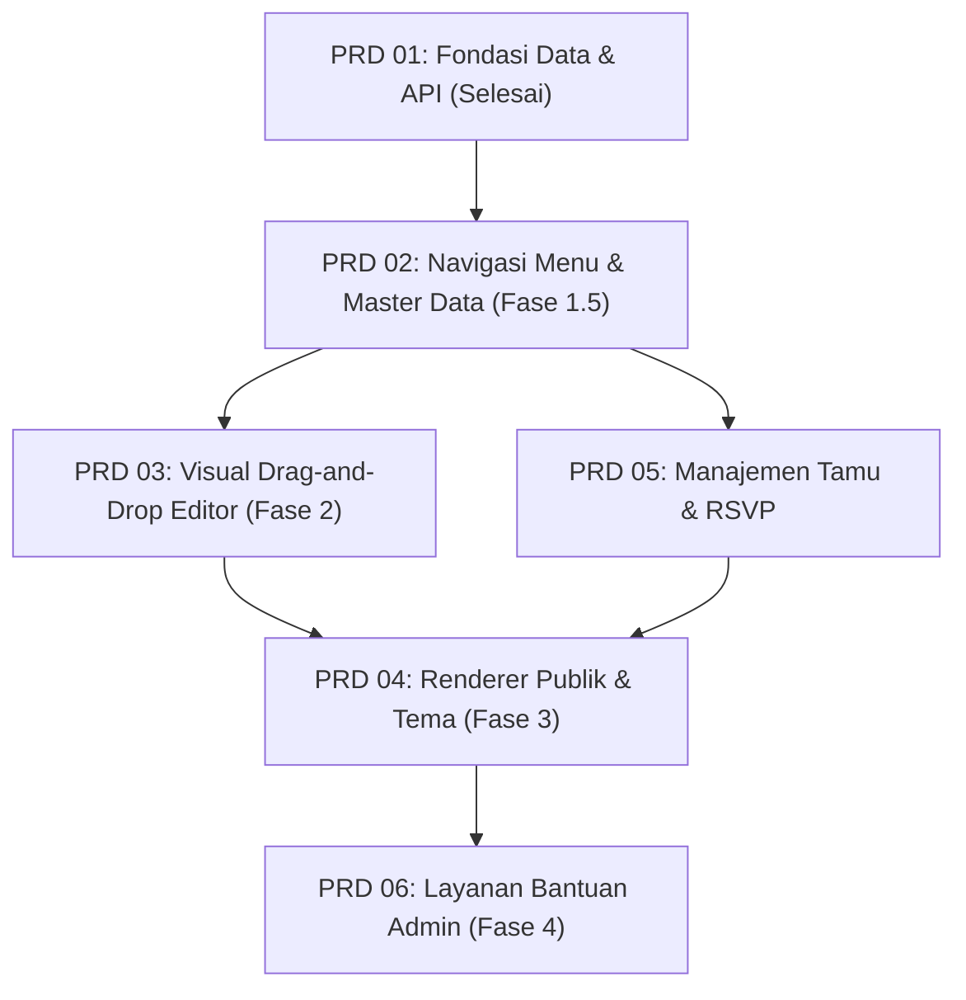

# Product Requirement Documents (PRD): Niskala

**Dokumen Induk:** [project-plan-undangan-digital.md](file:///var/www/html/niskala/docs/project-plan-undangan-digital.md)  
**Tujuan Direktori:** Memecah rencana makro platform undangan digital Niskala menjadi modul-modul spesifikasi produk (PRD) yang terfokus, terukur, dan siap diimplementasikan secara bertahap.

---

## 1. Peta & Matriks PRD

Dokumentasi kebutuhan produk dibagi ke dalam 6 modul spesifikasi utama:

| No | Berkas PRD | Fokus Modul | Fase Roadmap | Status |
|---|---|---|---|---|
| **01** | [01-fondasi-data-dan-api.md](file:///var/www/html/niskala/docs/prd/01-fondasi-data-dan-api.md) | Skema database, entity model, policy anti-IDOR, lifecycle state, reserved slugs, dan REST API. | **Fase 1** | **Selesai Diimplementasi** |
| **02** | [02-navigasi-menu-dan-master-data.md](file:///var/www/html/niskala/docs/prd/02-navigasi-menu-dan-master-data.md) | Struktur menu sidebar, master tema, master musik latar (`ms_music`), daftar undangan, dan wizard buat undangan baru. | **Fase 1.5** | **Selesai Diimplementasi** |
| **03** | [03-visual-editor.md](file:///var/www/html/niskala/docs/prd/03-visual-editor.md) | Editor visual drag-and-drop, component registry, mobile viewport canvas, property inspector, undo/redo, dan autosave. | **Fase 2** | **Siap Dikerjakan** |
| **04** | [04-renderer-publik-dan-tema.md](file:///var/www/html/niskala/docs/prd/04-renderer-publik-dan-tema.md) | Halaman publik `/{slug}`, mobile-first responsive, amplop/cover buka undangan, audio background, floating nav, dan tema MVP. | **Fase 3** | Menunggu Fase 2 |
| **05** | [05-manajemen-tamu-dan-rsvp.md](file:///var/www/html/niskala/docs/prd/05-manajemen-tamu-dan-rsvp.md) | Daftar tamu, personalisasi URL (`?to=Nama`), validasi & throttling RSVP, dan buku ucapan/doa interaktif. | **Fase 1.5 & 3** | Menunggu Fase 1.5 |
| **06** | [06-layanan-bantuan-admin.md](file:///var/www/html/niskala/docs/prd/06-layanan-bantuan-admin.md) | Alur permintaan bantuan (service order), peninjauan admin, kolaborasi pengeditan undangan, dan audit logs. | **Fase 4** | Menunggu Fase 3 |

---

## 2. Diagram Alur Ketergantungan Modul

---

## 3. Prinsip Kepatuhan Desain & Keamanan

Seluruh implementasi fitur pada tiap PRD wajib mematuhi dokumen standar proyek:
1. **Aturan Desain & Palet Warna ([design.md](file:///var/www/html/niskala/docs/design.md)):** Kaidah 60-30-10 (Ivory `#F1EDE5`, Charcoal `#34342F`, Muted Gold `#A68B65`).
2. **Aturan Keamanan ([rules.md](file:///var/www/html/niskala/docs/rules.md)):** Larangan IDOR, isolasi status draft, registry komponen tervalidasi (tanpa raw HTML/JS arbitrer), dan sanitasi input.
3. **Standar Arsitektur ([context.md](file:///var/www/html/niskala/docs/context.md)):** Stack multi-container Docker, Laravel Sanctum, React 19, dan MySQL 8.0 utf8mb4.

